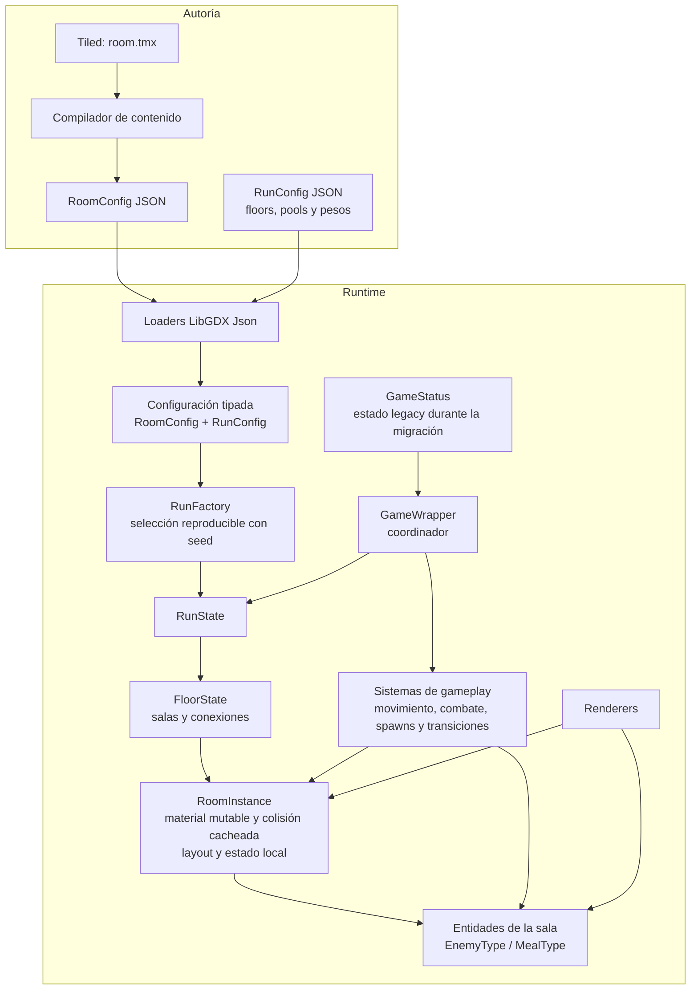

# Nyam Nyam — Dirección técnica del remake

Fuente de verdad de la **dirección arquitectónica orientativa y la autoría de contenido**, no de las reglas de producto ni del alcance inmediato. Consultar [GAME_DESIGN.md](GAME_DESIGN.md), [PROTOTYPE.md](PROTOTYPE.md) e [IDEAS.md](IDEAS.md) para esos ámbitos.

Destino: web jugable en móvil, con desktop como entorno de desarrollo. Mantener el flujo TMX legacy como comparación mientras el flujo de rooms JSON evoluciona. Este documento no es un inventario actualizado de funcionalidades implementadas: verificar el código antes de modificarlo.

## Arquitectura objetivo (borrador)

Este dibujo expresa una dirección para experimentar, no un contrato que haya que implementar literalmente. La idea es que Tiled siga siendo una herramienta de edición y que el runtime use datos propios sin cargar TMX.

### Responsabilidades orientativas

- `RoomConfig` describe geometría, materiales, propiedades de sala y alternativas de layout. Cada layout combina enemigos y comidas.
- `RunConfig` describe floors, candidatos de salas, pesos de selección, pools de contenido y temas visuales.
- Los loaders convierten los JSON en datos Java tipados. Los enums representan conceptos cerrados del juego, como materiales, enemigos, comidas y tipos de conexión. Los nombres de archivo localizan contenido editable.
- `RunFactory` crea una run con una semilla. Las selecciones usan el mismo generador aleatorio para poder reproducir una run durante depuración.
- `RunState` conserva el estado que cambia durante la partida: semilla, floor actual, conexiones y sala activa.
- `RoomInstance` copia solo los datos que necesita para jugar. Conserva la cuadrícula mutable, la colisión derivada y el estado local; no guarda el `RoomConfig` original.
- `GameWrapper` coordina sistemas y render, mientras el estado de la run y de la sala vive en sus propios objetos.

`GameStatus` conserva responsabilidades legacy. Su encaje con los nuevos recursos y `RunState` debe revisarse al implementar cada incremento; no trasladar sus reglas antiguas como requisitos del remake.

En el TMX de una room, la capa `room` define el material. El grupo `content` contiene un object layer por alternativa de layout; los objetos con nombre de enum (`BOOF`, `FRUIT_APPLE`, etc.) se convierten a spawns tipados. Los objetos se alinean a la cuadrícula y usan coordenadas de tiles desde la esquina inferior izquierda en el JSON. Las imágenes de tileset son solo previews de Tiled: `make compile-room ROOM=7 FORCE=1` genera el JSON de runtime sin referencias a esas imágenes.

## Criterios de evolución

- Mantener el estado mutable de partida y sala separado de las definiciones de contenido.
- Reutilizar las fronteras existentes (`GameplayContext`, `CollisionWorld`, factories y estados) cuando sean útiles, sin ampliar la refactorización TMX salvo que también beneficie al flujo JSON.
- Configuración mediante JSON tipado y enums para conceptos cerrados; evitar capas de indirección sin uso.
- La colisión se deriva del material y se cachea de forma que el terreno pueda mutar. Sombras y themes definitivos siguen pendientes.
- Focos de atracción y destinos deterministas por entidad ya explorados sirven como base de movimiento de burbujas; verificar su implementación antes de extenderlos.
- No convertir el diagrama en una obligación de crear clases o sistemas anticipadamente. El vocabulario de mundos/áreas del diseño no obliga a renombrar inmediatamente `FloorState`.

El inventario de reglas TMX y las brechas observadas durante la migración se conservan como referencia histórica en [LEGACY_GAME_DESIGN.md](LEGACY_GAME_DESIGN.md#inventario-técnico-de-migración-referencia-histórica).
