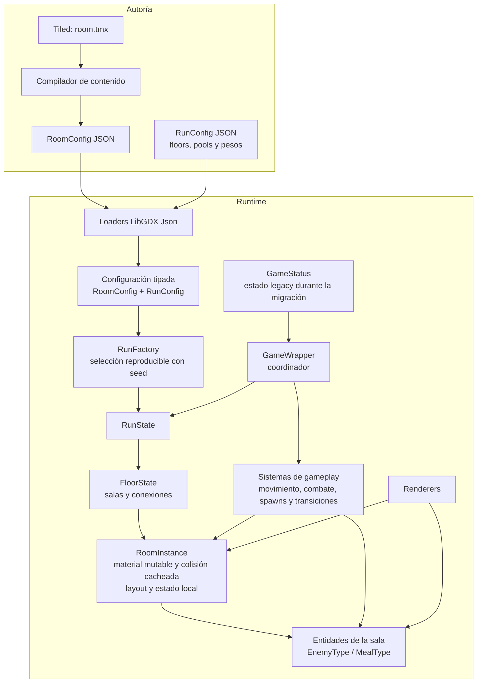

# Nyam Nyam — Dirección técnica del remake

Fuente de verdad de la **dirección arquitectónica orientativa y la autoría de contenido**, no de las reglas de producto ni del alcance inmediato. Consultar [GAME_DESIGN.md](GAME_DESIGN.md), [PROTOTYPE.md](PROTOTYPE.md) e [IDEAS.md](IDEAS.md) para esos ámbitos.

Destino: web jugable en móvil, con desktop como entorno de desarrollo. Mantener el flujo TMX legacy como comparación mientras el flujo de rooms JSON evoluciona. La sección de runtime implementado refleja la primera build probada de forma exploratoria en Desktop hasta el 24/11/2026; la prueba larga y en HTML/móvil sigue pendiente. El diagrama objetivo sigue siendo orientativo. Verificar el código antes de modificarlo.

La referencia de escala y las convenciones de producción de arte viven en [ART_GUIDE.md](ART_GUIDE.md). Sus tamaños de canvas no cambian automáticamente las dimensiones lógicas ni las colisiones.

## Arquitectura objetivo (borrador)

Este dibujo expresa una dirección para experimentar, no un contrato que haya que implementar literalmente. La idea es que Tiled siga siendo una herramienta de edición y que el runtime use datos propios sin cargar TMX.

### Responsabilidades orientativas

- `RoomConfig` describe geometría, materiales, propiedades de sala y alternativas de layout. Cada layout combina enemigos y comidas.
- `RunConfig` describe floors, candidatos de salas, pesos de selección, pools de contenido y temas visuales.
- Los loaders convierten los JSON en datos Java tipados. Los enums representan conceptos cerrados del juego, como materiales, enemigos, comidas y tipos de conexión. Los nombres de archivo localizan contenido editable.
- `RunFactory` crea una run con una semilla. Las selecciones usan el mismo generador aleatorio para poder reproducir una run durante depuración.
- `RunState` conserva el estado que cambia durante la partida: semilla, floor actual, conexiones y sala activa.
- `RoomInstance` copia solo los datos que necesita para jugar. Conserva la cuadrícula mutable, la colisión derivada y el estado local; no guarda el `RoomConfig` original.
- `GameWrapper` coordina sistemas y render, mientras el estado de la run y de la sala vive en sus propios objetos.

`GameStatus` conserva responsabilidades legacy. Su encaje con los nuevos recursos y `RunState` debe revisarse al implementar cada incremento; no trasladar sus reglas antiguas como requisitos del remake.

En el TMX de una room, la capa `room` define el material. El grupo `content` contiene un object layer por alternativa de layout; los objetos con nombre de enum (`BOOF`, `FRUIT_APPLE`, etc.) se convierten a spawns tipados. Los objetos se alinean a la cuadrícula y usan coordenadas de tiles desde la esquina inferior izquierda en el JSON. Las imágenes de tileset son solo previews de Tiled: `make compile-room ROOM=7 FORCE=1` genera el JSON de runtime sin referencias a esas imágenes.

### Próxima autoría modular — contrato por cerrar

El área usa una cuadrícula **lógica**: cada sala declara su huella como módulos locales conexos y conectores disponibles en aristas exteriores, identificados por módulo local y dirección cardinal. Cada conector referencia además una posición física de paso y llegada dentro de su TMX. Una sala 2×2 puede ofrecer dos conectores oeste; el generador puede enlazarlos a dos salas distintas. El enlace usa vecindad modular y direcciones opuestas; no exige que coordenadas en píxeles o dimensiones TMX coincidan entre salas. Solo la sala activa se carga y simula; la transición coloca al personaje en el acceso asociado de la otra sala.

La huella no impone una medida en tiles por módulo. Tampoco existe un separador obligatorio de un tile entre módulos. La actual room de 18×23 tiles obtiene un mundo de 20×25 mediante un margen implícito de colisión de un tile; esto es **comportamiento actual**, no fórmula para rooms nuevas ni para su huella. `GameplayCamera` puede seguir al personaje en salas físicas mayores conservando el FitViewport de referencia. Hay que definir dónde se guardan huella, posición y apertura física de los conectores en TMX/JSON, la conversión entre coordenadas TMX y runtime, y cómo se cierran los conectores no elegidos sin romper la geometría. Los huecos y spawns se validarán con la hitbox y el salto reales.

Estado del código al iniciar P10: `compile_stage.py` exporta material, layouts y focos, pero no huella ni conectores; acepta solo nombres numéricos. `RunFactory` crea una sala fija y `FloorState` solo contiene una lista e índice, sin posiciones ni grafo. `RunRuntime` construye sistemas para la sala corriente y usa un spawn fijo; `RoomCollisionWorld` presupone recinto cerrado. La prueba requiere sustituir esas suposiciones **en el flujo JSON** sin arrastrar reglas de navegación al TMX legacy. La identidad/posición/conexiones de las salas pertenecen al estado del área; su geometría y cambios locales se conservan durante la run, mientras entidades y sistemas vivos pertenecen únicamente a la sala activa. No crear simultáneamente un `RunRuntime` por sala.

Antes de implementar, resolver el contrato mínimo de datos y coordenadas con una plantilla pequeña y otra en L. El algoritmo de generación, catálogo y reintentos por seed deben ser suficientes para la prueba descrita en PROTOTYPE.md, sin convertir una estrategia provisional en regla de diseño definitiva.

## Runtime JSON implementado

El flujo JSON usa RunRuntime; GameWrapper conserva el flujo TMX para comparación. GameScreen selecciona el runtime y coordina UI/input, sin alojar las reglas nuevas de combate, recursos o resolución de sala.

| Frontera | Responsabilidad actual |
| --- | --- |
| `RunState` | Floors/sala actual, recursos persistentes entre salas, modificadores de Power/Cadence/Salivation y mutaciones binarias de la build |
| `RoomInstance` | Material, colisión/layout y combatCleared; sin salud/saliva ni reglas de puertas implícitas |
| `EntityWorld` | Colecciones y actualización/render/limpieza de enemigos, comida, proyectiles, mascotas y Bubble; reúne cuerpos para la física JSON |
| `GameplayContext` | Servicios de gameplay accesibles a entidades. Los nuevos servicios opcionales son null en TMX |
| `CollisionLayer` / `CollisionBody` | Categorías lógicas y datos de contacto de entidades; independientes de capas de render/Tiled |
| `RunPhysicsSystem` | Gravedad y terreno de objetos `FREE`, separación entre ellos y respuesta física a contactos según capas en JSON |
| `RunCombatService` | Resistencia/Power, captura al agotar resistencia o por contacto con burbuja vacía, fuga/restauración y remate; atajo debug de derrota masiva |
| `BubbleContactSystem` / `BubbleTerrain` | Contacto del jugador, presión, agrupación, propagación iterativa y bloqueo por terreno |
| `BubbleAttractionService` | Velocidad hacia focos de la room; foco/destino por entidad |
| `RoomCompletionService` | Marca combate resuelto cuando no quedan enemigos libres ni cautivos. No emite WIN, UI, recompensas ni apertura de puertas |
| `RunDropService` | Evaluación de drops al rematar, vuelos/cuerpos visuales, comida y propiedad/limpieza de pickups JSON |
| `DropLaunch` | Vuelo visual de recompensas hasta aterrizar; entonces se crean los pickups o la comida física |
| `RunSurvivalService` | Daño de salud JSON, protección tras impacto y presentación de muerte antes de LOSE, sin respawn/vidas persistentes |
| `GameUserInterface` / `ToothShape` | Representación provisional en viewport UI; mismo cuadrado de salud para HUD y pickups |

### Captura y ciclo de vida

Bubble es una Entity propia, no Meal/Air/Candy. Puede estar vacía o poseer una instancia Enemy. Capturar retira al enemigo de la colección de enemigos libres, lo deshabilita y suspende IA/colisiones; la burbuja lo posiciona y representa. No hay copia a otro Enemy ni doble actualización.

`RunCombatService` comprueba el contacto de burbujas vacías con enemigos debilitados después de actualizar las entidades. `Bubble` conserva su edad desde el nacimiento; al capturar toma una sola vez el límite de vida efectivo de la build. La mutación no modifica el reloj de las vacías ni los límites ya fijados en otras capturas.

Expirar devuelve esa misma instancia al mundo mediante el servicio de combate. Estallar limpia la referencia de captura antes de resolver y liberar al enemigo. El reset/cleanup de la burbuja libera un cautivo que siga poseyendo al limpiar la sala, sin generar drops. No reconstruir desde EnemyType ni liberar dos veces una instancia pooled.

Los proyectiles persistentes registran IDs de impactos para no dañar repetidamente al mismo enemigo por solapamiento. Las cadenas descubren vecinos antes de resolver y no conservan referencias a entidades liberadas entre updates.

El cuerpo derrotado es una copia independiente de TextureRegion y posición, nunca un Enemy activo: puede girar/volar/desvanecerse sin retrasar la resolución ni retener el pool. Frutas y verduras siguen usando factories/pools existentes. ToothPickup es un placeholder poligonal propiedad del servicio, sin textura ni entidad pooled; se retira al recoger o limpiar. UpgradePickup comparte el ciclo RunPickup de colisión, recogida y render, y aplica su stat o mutación tipada al recoger; sus marcadores geométricos distinguen cada mejora sin assets nuevos. Los renderers añadidos se liberan al disponer el runtime/HUD.

### Física de sala y vuelos de drops

`CollisionLayer` define `PLAYER`, `ENEMY`, `FREE`, `ANCHORED` y `BOMB` como categorías lógicas, sin modificar el orden de dibujo ni la colisión de tiles. `RunPhysicsSystem` consulta los cuerpos de `EntityWorld` y los pickups de `RunDropService`. Aplica gravedad y respuesta al terreno cada frame a los `FREE`, incluida la comida colocada directamente en el JSON. Los `FREE` se separan entre sí; el protagonista puede atravesarlos y los desplaza lateralmente a velocidad limitada. La recogida se decide por el efecto del objeto: si no aporta nada, permanece en la sala. Los enemigos no empujan los `FREE`. `ANCHORED` tiene respuesta de bloqueo para el protagonista, pero aún no hay soportes/objetos anclados jugables; `BOMB` solo prepara la categoría de contacto y no representa todavía un refresco funcional en JSON.

`DropLaunch` conserva únicamente imagen, trayectoria y datos para crear la recompensa. Durante el vuelo queda fuera de `EntityWorld` y de `RunPhysicsSystem`: no recibe colisiones con entidades ni puede recogerse. Al cruzar una superficie al descender, `RunDropService` crea la comida pooled o el `RunPickup` físico exactamente una vez y retira el vuelo. La comida del layout y las recompensas ya aterrizadas comparten la física de `FREE`. El flujo TMX conserva sus estados y recogida legacy.

### Recursos, carga y derrota

ToothHealth guarda unidades enteras de medio diente; SalivationReserve usa una cantidad continua para regeneración. Ambos pertenecen a RunState, no a RoomInstance ni a GameStatus. Los valores y reglas jugables se recogen en GAME_DESIGN.md y PROTOTYPE.md.

`stage <n>` recarga contenido sin restaurar recursos. `restart` los restaura expresamente y recarga la sala actual. Esto todavía no implementa navegación ni conservación de enemigos/comida de salas visitadas. Nueva pantalla/run crea un RunState nuevo.

La entrada JSON usa idle y spawnTimer=-1: sin bloqueo SPAWN ni inmunidad inicial. El daño reutiliza el timer/parpadeo existente para su ventana de protección. Al agotar salud se usa una pose DEAD propia, sin los efectos legacy de DeadEntityState; después de una espera se llama a GameStatus.setGameState(LOSE). Cargar sala a cero no revive. Pausa detiene la espera.

GameStatus sigue siendo la señal de estado para los listeners y conserva puntuación/vidas legacy; no se ha migrado globalmente. El score de remate previo aún pasa por él, pero recoger comida o dientes no da puntos ni vidas extra. La salud JSON no consume vidas persistentes, no reduce boosts al recibir daño y no usa su respawn. StageCompletion queda reservado a TMX.

### Configuración, stats y herramientas de balance

- `PrototypeBalance`: constantes del prototipo JSON agrupadas por recurso, combate, supervivencia, burbujas, física de items y vuelos, con unidades/comentarios. Incluye tolerancias numéricas separadas de los controles de balance. Editar y recompilar; sin loader ni configuración en caliente.
- `RunStats`: solo modificadores tipados de Power, Cadence y Salivation; conserva las bases en sus fuentes actuales. Calcula `base × (1 + suma de modificadores)` sin componer sobre resultados anteriores. Runtime de combate, cadencia y regeneración consultan el valor efectivo; proyectiles ya emitidos no cambian. La consola Desktop ofrece `stats` como consulta de solo lectura.
- `RunMutation`: efectos discretos de la build. Burbuja Gigante se registra una vez en `RunState`; cada disparo nuevo conserva su escala hasta convertirse en burbuja vacía o capturar un enemigo. El tamaño de render, caja de impacto y huella ante el terreno comparten esa escala. Captura Prolongada se consulta al iniciar cada captura y fija su límite sin alterar otras burbujas.
- `RunPickup`: ciclo compartido mínimo (colisión, recogida y render) para `ToothPickup` y `UpgradePickup`. Cada subtipo aplica su resultado específico; no convierte toda recogida en salud. `DropLaunch` mantiene el vuelo visual y materializa el pickup al aterrizar.
- `EnemyDropConfig`: perfil común y excepciones por EnemyType. Incluye probabilidades de comida y de diente adicional; actualmente todas las especies usan el fallback común. No hay reglas de dificultad/Luck implementadas.
- `PickupType`: IDs numéricos explícitos y estables: 1–4 dientes provisionales, 5–7 mejoras de stats y 8–9 mutaciones de debug. No usar ordinal ni nombres provisionales como identidad persistente. Aún no es un catálogo general de objetos.
- `DebugConsole`: comandos `stage`, `restart`, `killall`, `spawn` y consulta de stats; disponibilidad actual solo Desktop. Sintaxis e IDs en [PROTOTYPE.md](PROTOTYPE.md#consola-de-debug).

No se ha introducido ECS ni sistema genérico de drops de calidad o efectos. Las constantes de movimiento/cadencia todavía compartidas con el legacy no se han trasladado indiscriminadamente.

## Criterios de evolución

- Mantener el estado mutable de partida y sala separado de las definiciones de contenido.
- Reutilizar las fronteras existentes (`GameplayContext`, `CollisionWorld`, factories y estados) cuando sean útiles, sin ampliar la refactorización TMX salvo que también beneficie al flujo JSON.
- Configuración mediante JSON tipado y enums para conceptos cerrados; evitar capas de indirección sin uso.
- La colisión se deriva del material y se cachea de forma que el terreno pueda mutar. Sombras y themes definitivos siguen pendientes.
- Focos de atracción y destinos deterministas por entidad ya explorados sirven como base de movimiento de burbujas; verificar su implementación antes de extenderlos.
- No convertir el diagrama en una obligación de crear clases o sistemas anticipadamente. El vocabulario de mundos/áreas del diseño no obliga a renombrar inmediatamente `FloorState`.

El inventario de reglas TMX y las brechas observadas durante la migración se conservan como referencia histórica en [LEGACY_GAME_DESIGN.md](LEGACY_GAME_DESIGN.md#inventario-técnico-de-migración-referencia-histórica).
