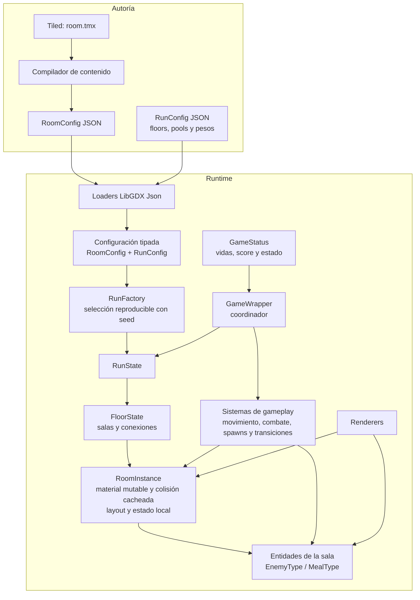

# Nyam Nyam — Dirección del remake

Queremos publicar una versión web jugable en móvil aprovechando el juego existente. Por ahora conservamos su identidad de plataformas de acción: moverse, saltar, atacar, transformar enemigos en comida y comerla para superar el nivel. La primera versión mantiene el juego en horizontal.

## Trabajo definido

- Preparar la distribución web; desktop sigue siendo el entorno de desarrollo.
- Mantener las cuatro acciones táctiles actuales: izquierda, derecha, salto y disparo. Situar sus botones translúcidos sobre la escena para liberar la franja inferior sin ocultar demasiado el juego.

## Exploración

Haremos pruebas pequeñas antes de decidir cambios de diseño. Las líneas abiertas son:

- Reducir la superficie de las arenas, aproximadamente a una cuarta parte, y definir reglas para transformar mapas sin perder plataformas, enemigos, comida ni rutas de aire. Esto permite volver a probar una presentación vertical.
- Conectar arenas mediante puertas en lugar de avanzar automáticamente.
- Agrupar arenas en floors y explorar variación o selección aleatoria de mapas.
- Revisar el catálogo de comida y sus efectos.
- Revisar el papel de Nyam, Gluty y Tfly.

Estas exploraciones guían el remake, pero no forman parte de la primera versión hasta que una prueba justifique incorporarlas.

## Arquitectura objetivo (borrador)

Este dibujo expresa una dirección para experimentar, no un contrato que haya que implementar literalmente. La idea es que Tiled siga siendo una herramienta de edición y que el runtime use datos propios sin cargar TMX.

### Responsabilidades orientativas

- `RoomConfig` describe geometría, materiales, propiedades de sala y alternativas de layout. Cada layout combina enemigos y comidas.
- `RunConfig` describe floors, candidatos de salas, pesos de selección, pools de contenido y temas visuales.
- Los loaders convierten los JSON en datos Java tipados. Los enums representan conceptos cerrados del juego, como materiales, enemigos, comidas y tipos de conexión. Los nombres de archivo localizan contenido editable.
- `RunFactory` crea una run con una semilla. Las selecciones usan el mismo generador aleatorio para poder reproducir una run durante depuración.
- `RunState` conserva el estado que cambia durante la partida: semilla, floor actual, conexiones y sala activa.
- `RoomInstance` copia solo los datos que necesita para jugar. Conserva la cuadrícula mutable, la colisión derivada y el estado local; no guarda el `RoomConfig` original.
- `GameWrapper` coordina sistemas y render, mientras el estado de la run y de la sala vive en sus propios objetos.

`GameStatus` ya gestiona vidas, puntuación y estados del juego. Su relación futura con el progreso de `RunState` queda abierta hasta decidir cómo funcionan las runs y la persistencia.

### Paso actual

La migración empieza con dos rutas separadas. Si existe `data/rooms/<nivel>.json`, `RunFactory` crea por ahora una run fija con un floor y una room, asigna a `FLOOR` una apariencia estática de `tiles.png` y `GameScreen` usa `RunRuntime`. Si no hay JSON, `GameScreen` sigue usando el flujo TMX existente. En niveles con ambos formatos, F11 alterna entre los dos flujos para comparar; en la ruta TMX, F10 conserva la previsualización de la geometría JSON.

La ruta JSON añade al jugador existente, movimiento, salto y disparo por teclado y mando, y colisiones consultadas desde `RoomInstance`. `GameplayContext` separa las entidades de `GameWrapper`; `CollisionWorld` adapta tanto las capas TMX como la geometría JSON. La room JSON representa solo el interior: el runtime impone límites invisibles de un tile alrededor, sin dibujar todavía esas walls. `RoomConfig` puede definir layouts con spawns de enemigos tipados; por ahora se carga el primero y el nivel 7 declara un `BOOF` para probar el ciclo de combate.

Todavía faltan fondos y paredes visibles, layouts de comidas y transiciones entre rooms. `RunState` ya contiene floors y cada `FloorState` contiene rooms, aunque la factory solo construye uno de cada. La apariencia fija es provisional; no define todavía un catálogo de themes. La selección reproducible con seed y los pools de floors pertenecen a una etapa posterior, cuando existan sus configuraciones.
