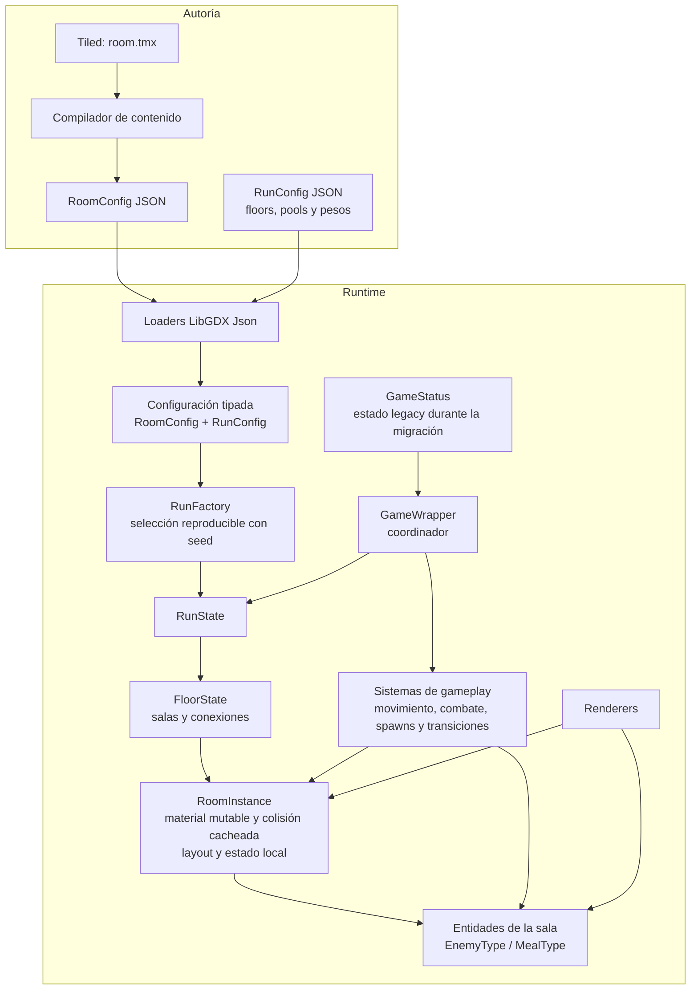

# Nyam Nyam — Dirección técnica del remake

Fuente de verdad de la **dirección arquitectónica orientativa y la autoría de contenido**, no de las reglas de producto ni del alcance inmediato. Consultar [GAME_DESIGN.md](GAME_DESIGN.md), [PROTOTYPE.md](PROTOTYPE.md) e [IDEAS.md](IDEAS.md) para esos ámbitos.

Destino: web jugable en móvil, con desktop como entorno de desarrollo. Mantener el flujo TMX legacy como comparación mientras el flujo de rooms JSON evoluciona. La sección de runtime implementado refleja la primera build probada de forma exploratoria en Desktop hasta el 24/11/2026; la prueba larga y en HTML/móvil sigue pendiente. El diagrama objetivo sigue siendo orientativo. Verificar el código antes de modificarlo.

La referencia de escala y las convenciones de producción de arte viven en [ART_GUIDE.md](ART_GUIDE.md). Sus tamaños de canvas no cambian automáticamente las dimensiones lógicas ni las colisiones.

## Arquitectura objetivo (borrador)

Este dibujo expresa una dirección para experimentar, no un contrato que haya que implementar literalmente. La idea es que Tiled siga siendo una herramienta de edición y que el runtime use datos propios sin cargar TMX.

### Responsabilidades orientativas

- `RoomConfig` describe geometría, materiales, propiedades de sala y alternativas de layout. Cada layout combina enemigos y comidas.
- `RunConfig` describe floors, candidatos de salas, pesos de selección, pools de contenido y temas visuales.
- Los loaders convierten los JSON en datos Java tipados. Los enums representan conceptos cerrados del juego, como materiales, enemigos, comidas y tipos de conexión. Los nombres de archivo localizan contenido editable.
- `RunFactory` crea una run con una semilla. Las selecciones usan el mismo generador aleatorio para poder reproducir una run durante depuración.
- `RunState` conserva el estado que cambia durante la partida: semilla, floor actual, conexiones y sala activa.
- `RoomInstance` copia solo los datos que necesita para jugar. Conserva la cuadrícula mutable, la colisión derivada y el estado local; no guarda el `RoomConfig` original.
- `GameWrapper` coordina sistemas y render, mientras el estado de la run y de la sala vive en sus propios objetos.

`GameStatus` conserva responsabilidades legacy. Su encaje con los nuevos recursos y `RunState` debe revisarse al implementar cada incremento; no trasladar sus reglas antiguas como requisitos del remake.

En el TMX de una room, la capa `room` define el material. El grupo `content` contiene un object layer por alternativa de layout; los objetos con nombre de enum (`BOOF`, `FRUIT_APPLE`, etc.) se convierten a spawns tipados. Los objetos se alinean a la cuadrícula y usan coordenadas de tiles desde la esquina inferior izquierda en el JSON. Las imágenes de tileset son solo previews de Tiled: `make compile-room ROOM=7 FORCE=1` genera el JSON de runtime sin referencias a esas imágenes.

### Autoría modular — contrato inicial de huellas y conectores

El área usa una cuadrícula **lógica**: cada sala declara su huella como módulos locales conexos y conectores disponibles en aristas exteriores, identificados por módulo local y dirección cardinal. Una sala 2×2 puede ofrecer dos conectores oeste; el generador puede enlazarlos a dos salas distintas. El enlace usa vecindad modular y direcciones opuestas; **no compara filas, columnas ni píxeles** entre las dos puertas. Así, `E0` puede enlazar con `W1` aunque estén a alturas distintas. Solo la sala activa se carga y simula; la transición entra por la geometría del conector de destino.

Cada módulo lógico tiene una superficie estándar de 20×25 tiles de mundo. El margen exterior de un tile sigue implícito, así que una huella de `ancho×alto` módulos usa un TMX de `(20×ancho−2) × (25×alto−2)` tiles editables. La room estándar `7.tmx` y la plantilla 1×1 miden 18×23; las salas mayores conservan la misma escala y `GameplayCamera` las sigue con el FitViewport de referencia.

El contrato inicial toma de Isaac **forma + slots disponibles + enlaces elegidos**, sin copiar su orden de numeración. El TMX declara la huella en la propiedad de mapa `footprint`, por ejemplo `0,0;1,0;0,1` para una L. Son coordenadas enteras no negativas de módulos locales, con origen en la esquina inferior izquierda; la huella debe empezar en `x=0,y=0` y ser conexa. El compilador acepta nombres de room alfanuméricos, además de `7`, sin rotar TMX. Las rooms anteriores sin `footprint`, como la 7, se cargan como una huella lógica 1×1 sin conectores.

La capa de objetos `connectors` contiene, por cada acceso **disponible**, un objeto de tipo `door` llamado `W0`, `E1`, `N0`, etc. `W/E` son líneas verticales sin grosor de 3 tiles de alto; `N/S` son rectángulos de 2×3 tiles. En las puertas frontales, el portal plano central de 0×3 es una interpretación futura del rectángulo; no se dibuja un segundo objeto. No hay puntos `arrival`: la entrada y la salida usan el propio conector. El objeto de puerta **fija su posición física en Tiled**: el compilador conserva y valida su geometría y su módulo, sin imponerle una fila o columna interior. El índice se calcula entre **todas** las aristas lógicas exteriores de esa dirección, aunque la plantilla no ofrezca todas: `W/E` de abajo arriba y `N/S` de izquierda a derecha. El orden físico de las puertas no tiene que coincidir con esos índices.

La línea lateral o el borde exterior del rectángulo frontal toca el perímetro físico de su módulo, incluso en el entrante de una L. El exterior debe pertenecer a un módulo ausente o estar fuera del TMX; el paso interior debe pertenecer al módulo del slot y estar libre de exclusiones y material. Tiled usa origen superior izquierdo; el compilador exporta rectángulos/líneas en píxeles desde el origen inferior izquierdo. La transición usa la geometría del conector de destino, sin intentar alinear físicamente las dos rooms.

Cada módulo ocupado aporta su superficie al recinto. Una capa de objetos opcional `exclusions` puede contener rectángulos alineados a la cuadrícula de 16 px, cada uno dentro de **un solo módulo ocupado**, para recortar franjas o regiones irregulares. Los objetos pueden tener un nombre descriptivo, pero no necesitan un tipo ni propiedades. El módulo ausente de una L queda fuera automáticamente y no requiere un objeto `void`. El compilador combina estas áreas en `playableCells`: `1` indica pertenencia al recinto, incluso si la celda contiene suelo; `0` indica exterior o exclusión. Las exclusiones no pueden cubrir material ni puertas, no cambian la huella lógica ni los slots, no son tiles `SOLID` y no pueden destruirse. Los objetos `room` siguen definiendo el terreno por separado. `RoomInstance` carga el área; la contención usa `playableCells`, mientras los enlaces y las transiciones pertenecen a navegación.

Para el primer recorrido sin combate hay plantillas en `art_files/stages/rooms/nav_*.tmx`, compiladas a `assets/data/rooms/nav_*.json`: `nav_1x1` (18×23), `nav_1x2` (18×48), `nav_2x1` (38×23), `nav_2x2` (38×48) y `nav_l_gap_bl`, `nav_l_gap_br`, `nav_l_gap_tl`, `nav_l_gap_tr` (38×48; el sufijo indica el **módulo ausente**). Las cuatro L ofrecen slots en su entrante. `nav_l_gap_tr` añade una muesca de exclusión de 2×4 tiles en el borde izquierdo del módulo inferior izquierdo; sirve como ejemplo de máscara local, independiente del módulo superior derecho ausente.

`nav_1x1_corridor.tmx` es otro ejemplo: `footprint=0,0` conserva el módulo lógico 1×1, pero dos rectángulos `upper_exclusion` y `lower_exclusion` en `exclusions` dejan únicamente las filas 15–18 del TMX como área jugable. La fila 18 contiene suelo; `W0` y `E0` son los únicos conectores. Para modificar el pasillo en Tiled, cambia esos rectángulos y los tiles de suelo manteniendo libre el paso de tres tiles de alto junto a cada puerta. Ninguna plantilla contiene enemigos, comidas o loot. Recorrido, salto, contención y transiciones requieren validación manual cuando el runtime aplique los límites y abra los enlaces.

### Catálogos de mundo y compilación

`assets/data/worlds/<world>.json` contiene `rooms` (rutas relativas a `assets/data/rooms/`, sin extensión) y `theme` (enum `RoomAppearance`). `WorldLoader` usa LibGDX Json para cargar `WorldConfig`; `RunFactory` pasa el catálogo al generador y no lo conserva en el estado vivo. El tema se asigna al material en la creación de cada instancia, sin incorporarlo a la geometría compilada. Por ahora solo existe `STATIC_TILES`; no hay selección de skins, pools o pesos.

El primer catálogo, `world_01`, reúne diez adaptaciones de los originales 1–5: cinco salas 1×1, dos 1×2, dos 2×1 y una L. Sus TMX están en `art_files/stages/rooms/world_01/room_01.tmx` a `room_10.tmx`; cada mapa registra su procedencia en `sourceStage` y el motivo en `designNote`. Usan material, conectores y focos, con un layout inicial `0` de BOOFs. El catálogo `navigation` conserva las plantillas vacías `nav_*` como alternativa de depuración.

Compilar una sala conserva su subcarpeta: `make compile-room ROOM=world_01/room_01 FORCE=1`. Para compilar todas las salas referenciadas por un catálogo: `make compile-world WORLD=world_01 FORCE=1`. Ambos escriben en `assets/data/rooms/`; sin `FORCE`, rechazan reemplazar JSON existentes. Los tilesets compartidos siguen en `art_files/stages/room-tools/` y son únicamente previews de autoría.

`AreaGenerator` crea provisionalmente hasta siete salas distintas: la primera entrada del catálogo inicia el recorrido en 0,0, y las demás se seleccionan y ordenan por semilla. Mantiene hasta 64 intentos de crecimiento, rechaza solapamientos y conecta slots opuestos compatibles, incluidos bucles. Exige una rama, un callejón sin salida y enlaces en ambos ejes. Este tamaño, el uso de la primera entrada como inicio y la selección sin repeticiones son decisiones de implementación para la prueba, no reglas definitivas de mundo. Los catálogos pequeños o incompatibles pueden no satisfacer esas condiciones y producen un error acotado.

`FloorState` conserva la seed; cada `PlacedRoom` expone plantilla, origen modular, `RoomInstance`, enlaces bidireccionales y estado local guardado. Solo existe un runtime activo. El flujo habitual de `RunFactory.populate` sigue permitiendo cargar la sala de combate única para comparar.

En Desktop, `area <seed>` carga `world_01`; `area <seed> navigation` carga las plantillas vacías. `area` consulta mundo, semilla y sala actuales. `restart` reconstruye el mismo mundo con la misma semilla y restaura salud. El overlay dibuja el perímetro en azul, conectores activos en verde e inactivos en gris. Los laterales cambian de sala al empujar hacia su línea; los frontales lo hacen al tocar la línea central del rectángulo 2×3. La llegada usa la geometría del conector y la hitbox de Nyam; la puerta de entrada se desarma hasta abandonarla para evitar retorno inmediato.

Las transiciones guardan los residentes compatibles, liberan el runtime anterior y crean el de destino, manteniendo la salud de `RunState`. Persisten el material, el combate resuelto y los drops, tanto en vuelo como recogibles; el combate parcial (enemigos, cautivos y cuerpos derrotados pendientes) todavía no se conserva. Las puertas aún no se bloquean por combate: al regresar a una sala sin resolver se reconstruyen sus enemigos. La próxima iteración debe cerrar ese ciclo antes de tratar el recorrido como una run de combate completa. El tránsito es instantáneo; el overlay y las entradas requieren revisión manual y no representan arte final.

El mapa modular de depuración se dibuja en la esquina superior derecha del HUD únicamente durante `area <seed>`, ocupando provisionalmente el lugar del botón de pausa. Usa la huella de cada `PlacedRoom` para colorear todos sus módulos como una sola sala, sin líneas internas; el número repetido identifica su pertenencia incluso en una L. El amarillo marca la sala actual, el verde los enlaces elegidos y el gris los conectores disponibles sin enlace. El encabezado muestra la seed y el índice de sala; `area` sin argumentos consulta ambos en la consola, y `area <seed>` permite repetir o cambiar el recorrido. Es una vista completa, sin niebla de exploración ni posición exacta del jugador. Quedan pendientes la validación manual de varias semillas, de una rama con callejón sin salida, de las cuatro direcciones y del espacio que ocupa el overlay durante el juego.

## Runtime JSON implementado

El flujo JSON usa RunRuntime; GameWrapper conserva el flujo TMX para comparación. GameScreen selecciona el runtime y coordina UI/input, sin alojar las reglas nuevas de combate, recursos o resolución de sala.

**Runtime tras las primeras cinco tarjetas arcade (27/11/2026):** esta sección describe la implementación actual; el objetivo pendiente y las pruebas manuales están en [PROTOTYPE.md](PROTOTYPE.md#objetivo-actual--recuperar-el-combate-arcade-de-nyam). Las reglas de diseño vigentes están en [GAME_DESIGN.md](GAME_DESIGN.md#p7--combate-recursos-y-supervivencia). Actualizar esta fotografía al cambiar el código, sin tratar decisiones provisionales como requisitos.

| Frontera | Responsabilidad actual |
| --- | --- |
| `RunState` | Floors/sala actual y salud de dientes persistentes entre salas; sin salivación, modificadores ni mutaciones de build |
| `RoomInstance` | Material, colisión/layout y combatCleared; sin salud ni reglas de puertas implícitas |
| `EntityWorld` | Colecciones y actualización/render/limpieza de enemigos, comida, proyectiles, mascotas y Bubble; reúne cuerpos para la física JSON |
| `GameplayContext` | Servicios de gameplay accesibles a entidades. Los nuevos servicios opcionales son null en TMX |
| `CollisionLayer` / `CollisionBody` | Categorías lógicas y datos de contacto de entidades; independientes de capas de render/Tiled |
| `RunPhysicsSystem` | Gravedad y terreno de objetos `FREE`, separación entre ellos y respuesta física a contactos según capas en JSON |
| `RunCombatService` | Captura inmediata por impacto directo, fuga como ENFADADO, remate y atajo debug de derrota masiva; sin resistencia ni Power de combate |
| `BubbleContactSystem` / `BubbleTerrain` | Contacto del jugador, arrastre lateral, solapamiento/densidad de clusters, presión y propagación iterativa bloqueada por terreno |
| `BubbleAttractionService` | Velocidad hacia focos de la room; foco/destino por entidad |
| `RoomCompletionService` | Marca combate resuelto cuando no quedan enemigos libres ni cautivos. No emite WIN, UI, recompensas ni apertura de puertas |
| `RunDropService` | Evaluación de drops al rematar, vuelos/cuerpos visuales, comida y propiedad/limpieza de pickups JSON |
| `DropLaunch` | Vuelo visual de recompensas hasta aterrizar; entonces se crean los pickups o la comida física |
| `RunSurvivalService` | Daño de salud JSON, protección tras impacto y presentación de muerte antes de LOSE, sin respawn/vidas persistentes |
| `GameUserInterface` / `ToothShape` | Representación provisional en viewport UI; mismo cuadrado de salud para HUD y pickups |

### Captura y ciclo de vida

El ataque de Nyam usa `ProjectileType.BEAM` y las regiones legacy `BEAM` del atlas. `Bubble` es una Entity propia, no Meal/Air/Candy, y usa las animaciones `AIR_*`; el proyectil y la burbuja física son entidades visuales distintas. Una burbuja puede estar vacía o poseer una instancia Enemy. Capturar retira al enemigo de la colección de enemigos libres, lo deshabilita y suspende IA/colisiones; la burbuja lo posiciona y representa. No hay copia a otro Enemy ni doble actualización.

`RunCombatService.hit` registra cada impacto una vez y captura inmediatamente a enemigos comunes en la misma instancia `Enemy`. No hay resistencia, Power, feedback de desgaste, pickups de build ni mutaciones experimentales en el runtime JSON. Al expirar una captura se libera la instancia como ENFADADO, sin restaurar resistencia ni generar drops; el remate resuelve y recompensa una sola vez. El runtime tampoco captura por contacto entre enemigos y burbujas existentes, estén vacías o contengan otro enemigo. `Bubble` mantiene un único ciclo de vida total de diez segundos desde su creación; capturar no reinicia ni prolonga el reloj.

Expirar devuelve esa misma instancia al mundo mediante el servicio de combate. Estallar limpia la referencia de captura antes de resolver y liberar al enemigo. El reset/cleanup de la burbuja libera un cautivo que siga poseyendo al limpiar la sala, sin generar drops. No reconstruir desde EnemyType ni liberar dos veces una instancia pooled.

Los proyectiles persistentes registran IDs de impactos para no procesar varias veces el contacto con un mismo enemigo durante un solapamiento. Las cadenas descubren vecinos antes de resolver y no conservan referencias a entidades liberadas entre updates.

El remate conserva la instancia del enemigo en `DefeatedEnemyFlight`, fuera de la IA y de los contactos normales. Gira y vuela hasta aterrizar en terreno; entonces se posa y se desvanece antes de liberar el pool. La resolución de sala espera a esos cuerpos pendientes. Frutas y verduras siguen usando factories/pools existentes. `ToothPickup` es un placeholder poligonal propiedad del servicio, sin textura ni entidad pooled; se retira al recoger o limpiar. Los renderers añadidos se liberan al disponer el runtime/HUD.

### Física de sala y vuelos de drops

`CollisionLayer` define `PLAYER`, `ENEMY`, `FREE`, `ANCHORED` y `BOMB` como categorías lógicas, sin modificar el orden de dibujo ni la colisión de tiles. `RunPhysicsSystem` consulta los cuerpos de `EntityWorld` y los pickups de `RunDropService`. Aplica gravedad y respuesta al terreno cada frame a los `FREE`, incluida la comida colocada directamente en el JSON. Los `FREE` se separan entre sí; el protagonista puede atravesarlos y los desplaza lateralmente a velocidad limitada. Frutas y verduras se recogen siempre; un pickup con efecto condicionado permanece si no puede aplicarse. Los enemigos no empujan los `FREE`. `ANCHORED` tiene respuesta de bloqueo para el protagonista, pero aún no hay soportes/objetos anclados jugables; `BOMB` solo prepara la categoría de contacto y no representa todavía un refresco funcional en JSON.

`DropLaunch` conserva únicamente imagen, trayectoria y datos para crear la recompensa. Durante el vuelo queda fuera de `EntityWorld` y de `RunPhysicsSystem`: no recibe colisiones con entidades ni puede recogerse. Al cruzar una superficie al descender, `RunDropService` crea la comida pooled o el `RunPickup` físico exactamente una vez y retira el vuelo. La comida del layout y las recompensas ya aterrizadas comparten la física de `FREE`. El flujo TMX conserva sus estados y recogida legacy.

### Recursos, carga y derrota

ToothHealth guarda unidades enteras de medio diente en RunState, fuera de RoomInstance y GameStatus. Ya no existe reserva de salivación en el flujo JSON; el ataque se rige por Cadence base. Las reglas jugables están en [P7.B–C](GAME_DESIGN.md#p7b--ataque-libre-y-comida-común).

`stage <n>` recarga contenido sin restaurar recursos. `restart` los restaura expresamente y recarga la sala actual. La navegación modular conserva los residentes descritos en el contrato de catálogos; los enemigos de combates parciales aún se reconstruyen. Nueva pantalla/run crea un RunState nuevo.

La entrada JSON usa idle y spawnTimer=-1: sin bloqueo SPAWN ni inmunidad inicial. El daño reutiliza el timer/parpadeo existente para su ventana de protección. Al agotar salud se usa una pose DEAD propia, sin los efectos legacy de DeadEntityState; después de una espera se llama a GameStatus.setGameState(LOSE). Cargar sala a cero no revive. Pausa detiene la espera.

GameStatus sigue siendo la señal de estado para los listeners y conserva puntuación/vidas legacy; no se ha migrado globalmente. El flujo JSON no lee ni concede puntuación: remates, comida y dientes tampoco activan vidas extra por puntos. Su HUD oculta score y limpia mensajes de puntos al entrar; el score de GameStatus y su presentación quedan para TMX. La salud JSON no consume vidas persistentes, no reduce boosts al recibir daño y no usa su respawn. StageCompletion queda reservado a TMX.

### Configuración y herramientas de balance

- `PrototypeBalance`: constantes del prototipo JSON agrupadas por supervivencia, burbujas, física de items y vuelos, con unidades/comentarios. Incluye tolerancias numéricas separadas de los controles de balance. Editar y recompilar; sin loader ni configuración en caliente.
- Los modificadores de Power, Cadence y Salivation, las mutaciones Burbuja Gigante/Captura Prolongada y el recurso de salivación se retiraron del runtime JSON. El ataque usa la Cadence base.
- `RunPickup`: ciclo compartido mínimo (colisión, recogida y render) para `ToothPickup`; `DropLaunch` mantiene el vuelo visual y materializa el pickup al aterrizar.
- `EnemyDropConfig`: perfil común y excepciones por EnemyType. Incluye probabilidades de comida y de diente adicional; actualmente todas las especies usan el fallback común. No hay reglas de dificultad/Luck implementadas.
- `PickupType`: IDs numéricos explícitos y estables: 1–4 dientes provisionales; 5–9 están reservados y no aparecen en la enumeración. No usar ordinal ni nombres provisionales como identidad persistente. Aún no es un catálogo general de objetos.
- `DebugConsole`: comandos `stage`, `restart`, `killall`, `spawn` y `stats`; disponibilidad actual solo Desktop. `spawn list` ofrece dientes 1–4 e identifica 5–9 como reservados. `stats` consulta solo Cadence base. Los comandos conservados para la prueba se resumen en [PROTOTYPE.md](PROTOTYPE.md#valores-y-herramientas-que-se-conservan-para-la-prueba).

No se ha introducido ECS ni sistema genérico de drops de calidad o efectos. Las constantes de movimiento/cadencia todavía compartidas con el legacy no se han trasladado indiscriminadamente.

## Criterios de evolución

- Mantener el estado mutable de partida y sala separado de las definiciones de contenido.
- Reutilizar las fronteras existentes (`GameplayContext`, `CollisionWorld`, factories y estados) cuando sean útiles, sin ampliar la refactorización TMX salvo que también beneficie al flujo JSON.
- Configuración mediante JSON tipado y enums para conceptos cerrados; evitar capas de indirección sin uso.
- La colisión se deriva del material y se cachea de forma que el terreno pueda mutar. Sombras y themes definitivos siguen pendientes.
- Focos de atracción y destinos deterministas por entidad ya explorados sirven como base de movimiento de burbujas; verificar su implementación antes de extenderlos.
- No convertir el diagrama en una obligación de crear clases o sistemas anticipadamente. El vocabulario de mundos/áreas del diseño no obliga a renombrar inmediatamente `FloorState`.

El inventario de reglas TMX y las brechas observadas durante la migración se conservan como referencia histórica en [LEGACY_GAME_DESIGN.md](LEGACY_GAME_DESIGN.md#inventario-técnico-de-migración-referencia-histórica).
